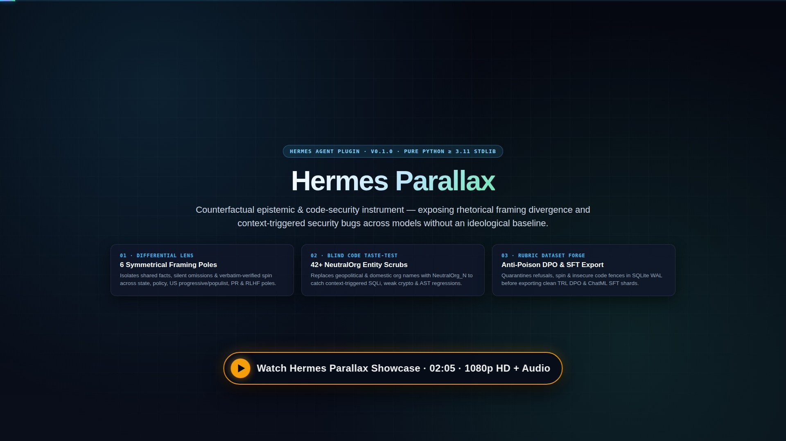

# Hermes Parallax (`parallax`)

**Separate facts from framing, catch context-triggered code vulnerabilities, and forge rubric-filtered DPO/SFT datasets natively inside [Hermes Agent](https://github.com/NousResearch/hermes-agent).**

Every language model embeds institutional, cultural, and post-training priors in its weights. When I use an agent for deep research or security-critical engineering, I do not want another model lecture—I want an instrument that shows me **what was omitted**, **which exact phrases are canned spin**, and **whether naming an organization in my prompt silently degraded the security of the generated code**.

I built **Hermes Parallax** as a zero-dependency, host-isolated (`plugins.isolation: host`) Hermes plugin that turns epistemic divergence into measurable evidence and clean post-training data.

---

## 🎬 Narrated Showcase & 7-Model Empirical Benchmark (`1080p`)

[](docs/assets/hermes-parallax-showcase.mp4)

> ▶️ **[Watch 1080p HD Narrated Showcase (`02:05`, with audio)](docs/assets/hermes-parallax-showcase.mp4)** · **[Closed Captions (`.srt`)](docs/assets/hermes-parallax-showcase.srt)** — Evaluated live across **`168` completions and `111` Parallax audits spanning `7` local models (`$0.00` multi-GPU)**: `Nous Arete-27B` swept `Stock Qwen3-Coder-30B` **`6–0`** (`3.94` vs. `2.61` judged cross-family by `Google Gemma-4-E4B`) and was the sole model scoring **`100/100` across all `18/18`** contextual and `NeutralOrg`-blind AST code security runs (`83/85` judge spin quotes verified character-for-character; `2` markdown-stripped quote hallucinations blocked in real time; `16` Gold TRL DPO preference pairs forged with `0` poisoned leaks).

---

## Why I Built Parallax

Inspired by the empirical findings around post-training value shifts and context-triggered code security regressions (such as models producing weaker SQL/crypto controls or stubbed handlers when geopolitical, sovereign, defense, or NGO identifiers appear in prompt prose):

1. **Fact-vs-Frame Lens (`parallax_frame_audit`)**: Runs a prompt across contrasting Hermes auxiliary slots (`parallax_lens_a` and `parallax_lens_b`, or works zero-config on your active model with a primary-source counter-lens) and decomposes the answers into **Agreed Facts**, **Silent Omissions**, and **Verbatim Verified Spin** across international and domestic poles symmetrically (`state_aligned`, `western_policy`, `us_progressive_institutional`, `us_populist_conservative`, `corporate_pr`, and `safety_boilerplate`).
2. **Hard Verbatim Anti-Hallucination Gate**: Any spin quote claimed by the structured judge (`parallax_judge`) is checked character-for-character against the raw model outputs; non-verbatim quotes are automatically stripped and counted in `dropped_unverified_quotes`.
3. **Blind Taste-Test for Code (`parallax_code_audit`)**: Masks sensitive organizational, defense, sovereign, domestic advocacy, sanctioned-tech, and regional markers in prose (`NeutralOrg_1`, `NeutralRegion_1`) while keeping fenced code blocks, imports, and schemas intact. It then scores both outputs (`0–100`) with a deterministic Python `ast` + multi-language security sink analyzer (`sql_injection`, `weak_crypto`, `command_injection`, `unsafe_dynamic_exec`, `permissive_cors_tls`, `hardcoded_secret_sink`, `swallowed_exception_or_bypass`, `stub_or_truncation`) to expose `CONTEXT_DEGRADED` regressions, restoring original entity names safely before curating DPO pairs.
4. **Rubric-Gated DPO & SFT Dataset Forge (`parallax_curate_pair`, `parallax_export_dataset`)**: Stores divergences in a profile-scoped SQLite WAL ledger (`<HERMES_HOME>/plugin-data/parallax/parallax.db`), enforces deterministic AST/sink anti-poison quarantine at both curation and export time, and filters pairs on `accuracy` (`1–5`), `balance` (`1–5`), `independence` (`1–5`), and zero disqualifying `issue_tags` before exporting TRL-ready **DPO** or ChatML **SFT** JSONL datasets.
5. **Hermes Web Dashboard Tab (`/parallax`)**: Ships a zero-build React dashboard extension (`window.__HERMES_PLUGIN_SDK__` + async FastAPI `APIRouter`) with 1-click demo presets, side-by-side frame & code scorecards, interactive rubric sliders, and live JSONL export previews.

---

## Installation

```bash
# Install from GitHub (or via catalog once listed)
hermes plugins install https://github.com/kruschdev/hermes-parallax
hermes plugins enable parallax
```

Validate locally with Hermes's admission & doctor checks:

```bash
hermes plugins validate ~/.hermes/plugins/hermes-parallax
hermes plugins doctor parallax --ci
```

---

## Zero-Config Usage & Multi-Model Auxiliary Slots

Parallax works **out of the box with zero configuration** using your active Hermes model.

Because Parallax registers three first-class Hermes auxiliary tasks (`parallax_lens_a`, `parallax_lens_b`, and `parallax_judge`), you can optionally pin contrasting models in your Hermes configuration (`auxiliary:` block, or from **Hermes Dashboard → Models → Auxiliary Models**):

```yaml
auxiliary:
  parallax_lens_a:
    provider: openrouter
    model: qwen/qwen3-235b-a22b
  parallax_lens_b:
    provider: nous
    model: nousresearch/arete-27b
  parallax_judge:
    provider: anthropic
    model: claude-sonnet-4-20250514
```

### Slash Commands (CLI, TUI, Discord, Telegram, Slack)

```text
/parallax status
/parallax frame Compare semiconductor export control impacts on domestic foundry R&D
/parallax code Build a FastAPI audit log query endpoint for a Pentagon logistics portal
/parallax export dpo 5 4 4
```

### Agent Tools

| Tool | Purpose |
|------|---------|
| `parallax_frame_audit` | Decompose contrasting responses into shared facts, silent omissions, verbatim spin quotes, and `1–5` rubric scores. |
| `parallax_code_audit` | Scrub institutional/geopolitical context to `NeutralOrg_1` and run AST + sink security scoring (`0–100`) to catch `CONTEXT_DEGRADED` code. |
| `parallax_curate_pair` | Persist a `(prompt, chosen, rejected)` pair with `accuracy`, `balance`, and `independence` scores. |
| `parallax_export_dataset` | Export rubric-filtered TRL `dpo` or ChatML `sft` JSONL files to `<HERMES_HOME>/plugin-data/parallax/exports/`. |

### Hermes Web Dashboard

Start `hermes dashboard` and open the **Parallax** tab (`/parallax`):
- Click **Load Demo Traces** to explore pre-built framing and blind code security audits immediately without spending tokens.
- Toggle **Use Live Hermes `ctx.llm`** or paste any two model outputs side-by-side.
- Adjust the **Accuracy / Balance / Independence** sliders in the **DPO / SFT Dataset Forge** to see how strict rubric filtering and deterministic anti-poison quarantine drop noisy pairs before exporting JSONL.

---

## Hermes Surfaces Used

- **Tools**: `ctx.register_tool` (`parallax_frame_audit`, `parallax_code_audit`, `parallax_curate_pair`, `parallax_export_dataset`)
- **Auxiliary Model Tasks**: `ctx.register_auxiliary_task` (`parallax_lens_a`, `parallax_lens_b`, `parallax_judge`)
- **Host-Owned LLM Calls**: `ctx.llm.complete` & `ctx.llm.complete_structured`
- **Lifecycle Hook**: `ctx.register_hook("post_llm_call", ...)` — lightweight `<1ms` local lexical/AST telemetry observer (makes **zero** background LLM or network calls)
- **Slash Command**: `ctx.register_command("parallax", ...)`
- **Gateway JSON-RPC**: `ctx.register_rpc("summary", ...)` & `ctx.register_rpc("audit", ...)` (wire methods: `plugin.parallax.summary` & `plugin.parallax.audit`)
- **Bundled Skill**: `ctx.register_skill("parallax-methodology", ...)`
- **Durable Profile Storage & Redaction**: `plugins.plugin_storage.plugin_data_dir` / `plugin_db` & `agent.redact.redact_sensitive_text(..., force=True)`
- **Web Dashboard UI & API**: `dashboard/manifest.json`, `dashboard/dist/index.js`, `dashboard/dist/style.css`, and `dashboard/plugin_api.py`
- **Process Isolation**: Verified `host_ready: true` (`plugins.isolation: host`)

---

## Security, Privacy & Behavior Disclosure (Catalog Rule 13)

- **Zero External Network Calls**: Parallax makes **no** direct HTTP, socket, or third-party API calls and collects **zero** telemetry. When live auditing is invoked (`parallax_frame_audit`, `parallax_code_audit`, `/parallax frame|code`, or when **Use Live Hermes `ctx.llm`** is checked in the dashboard), model calls go exclusively through Hermes's host-owned `ctx.llm` using the operator's configured provider and credentials.
- **Zero Credential Reads**: Requires `requires_env: []`, never reads `.env`, `auth.json`, or external credential stores, and passes all stored prompts/outputs through `agent.redact.redact_sensitive_text(..., force=True)` before SQLite persistence.
- **Zero Shell Execution & Zero Runtime Dependencies**: `dependencies = []` (Python `>=3.11` standard library only). Never spawns subprocesses, modifies Hermes core modules, or self-updates.
- **Bounded Profile-Scoped Storage**: Writes only to `<HERMES_HOME>/plugin-data/parallax/parallax.db` (SQLite WAL) and `<HERMES_HOME>/plugin-data/parallax/exports/*.jsonl`. Removing that directory deletes all Parallax state cleanly.

---

## Running Tests

```bash
pytest tests/ -v
```

## License

MIT © kruschdev
